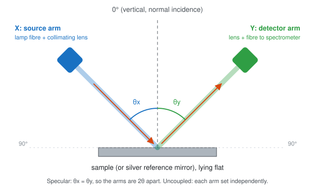
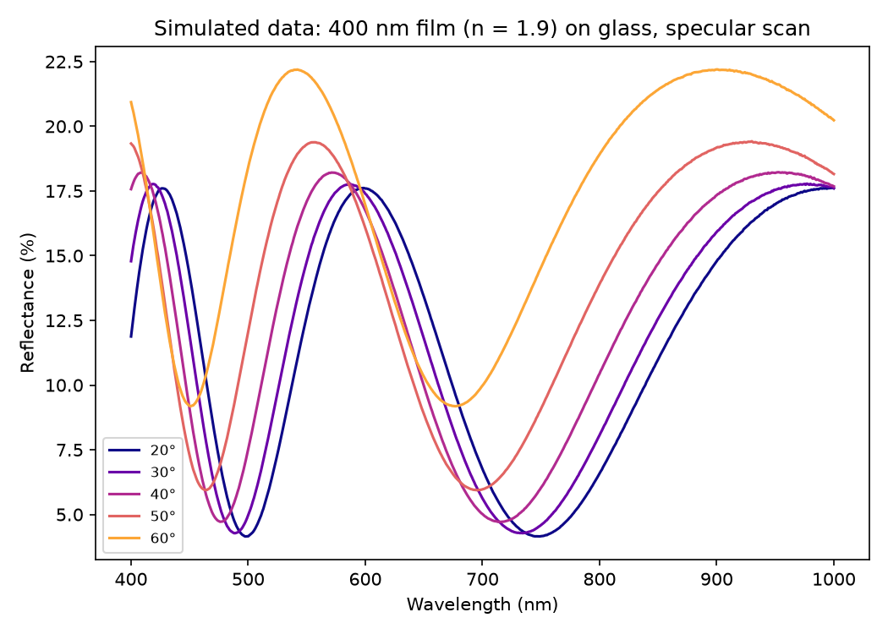

# Angle-resolved reflectance spectrometer

Control and analysis software for a small, home-built instrument that measures how a sample's reflectance spectrum changes with angle. Two motorised arms swing around the sample, one carrying the light source and the other the collection optics. A third motor turns a polariser.

The instrument was designed and built by Samuel Brooke in the [Nanoscience Laboratory](https://chemistry.unimelb.edu.au/) (group of Prof. James Hutchison), School of Chemistry, University of Melbourne, in 2024–2025. It is still in use there.

<!-- TODO(sam): photo of the instrument here, e.g. docs/images/instrument.jpg, with a one-line caption. -->
<!-- TODO(sam): check the group link above (swap for the group's own page if there is one). -->

## What it measures

At each pair of arm angles you record one spectrum. Dividing the sample's spectrum by a silver mirror's spectrum at the same geometry gives reflectance against wavelength and angle. Two kinds of scan are supported:

- **Specular:** both arms move together (θx = θy), so the detector always sees the mirror reflection. This tracks how thin-film interference fringes, plasmon resonances and similar features shift with angle of incidence.
- **Uncoupled:** one arm sweeps while the other is held, and the sweep repeats for each held angle. This maps light scattered away from the mirror direction.

<p align="center"></p>

Angles are measured from vertical. 0° is normal incidence and 90° is grazing. Each arm has its own angle, so in a specular scan at 45° the arms are 90° apart.

<p align="center"></p>

*Simulated data from the built-in simulator (see [Try it without the instrument](#try-it-without-the-instrument)). As the angle grows, the interference fringes of a transparent film move to shorter wavelength.*

<!-- TODO(sam): replace or join the simulated figure with a real measured set of spectra (e.g. ITO film), with sample details in the caption. -->

## Hardware

| Part | What was used |
|---|---|
| Light source | Ocean Optics DH-2000 deuterium–halogen lamp <!-- TODO(sam): confirm model (DH-2000, DH-2000-BAL, ...) --> |
| Fibres | Standard SMA-905 multimode fibres <!-- TODO(sam): core diameter / NA if known --> |
| Beam | Collimating lens on each fibre; about 2 mm spot on the sample |
| Polariser | Thorlabs 1-inch visible film polariser, turned by motor Z <!-- TODO(sam): which arm is it on? --> |
| Spectrometer | Ocean Optics UV–vis spectrometer for most work, an Ocean Optics NIR spectrometer for longer wavelengths <!-- TODO(sam): models --> |
| Reference | Protected silver mirror |
| Motion | Three stepper motors driven by an Arduino Uno with a CNC shield; a limit switch on each arm <!-- TODO(sam): motor and driver models, microstepping --> |
| Frame | <!-- TODO(sam): what the arms and frame are made of (3D printed? optical rail?) --> |

Software side:

- **Spectrometer:** used through Ocean Optics' own software (OceanView). Spectra are saved by hand, so any spectrometer that writes Ocean Optics–style text files works.
- **Motors:** the Uno firmware accepts plain-text commands over USB serial. The command set is documented in [`serial_protocol.py`](angle_resolved_spectrometer/motion/serial_protocol.py).

<!-- TODO(sam): publish the Uno firmware sketch (firmware/ folder) once found, and link it here. -->

## Taking a measurement

1. Start the control window with `python run_instrument.py --port COM7` (use your Uno's port).
2. Click **Home**. The arms find their limit switches and park at 10°.
3. Choose the **data folder**: the same folder the spectrometer software saves into.
4. Put the silver mirror in place. Choose **Reference (mirror)**, set the angles, and click **Start scan**.
5. At each point, record a raw spectrum and save it in the spectrometer software. Then click **Next point** (or press Enter). Also save one dark spectrum per run, with the source blocked and the same integration time, under a name like `reference_dark` or `sample_dark`. Any name that contains "dark" works.
6. Swap in the sample, choose **Sample**, and repeat.

The plan for each run is saved to `scan_list.json` in the data folder. The spectrometer software numbers its files in the order you save them, and the analysis uses that order to work out which file was taken at which angle. **Save exactly one spectrum per point.** If you stop a scan part way, delete that run's spectra before starting again.

## Analysing the data

```bash
python run_analysis.py PATH/TO/DATA_FOLDER --time-normalised --wavelength-range 440,1000
```

This runs five steps:

1. **Move darks.** Dark spectra go into `darc_files/`.
2. **Rename.** Each file gets its angles: `sample_FLMS12345_0003.txt` becomes `sample_FLMS12345_30.0,30.0.txt`. If `scan_list.json` is missing, the script asks for the specular scan range instead.
3. **Subtract darks.** Each run's dark is subtracted from that run's spectra.
4. **Compute reflectance.**

   R(λ) = 100 % × (S − D<sub>S</sub>) / (M − D<sub>M</sub>) × (t<sub>M</sub> / t<sub>S</sub>)

   S is the sample spectrum, M the mirror, D the darks and t the integration times. The time factor applies only with `--time-normalised`. R is relative to the mirror. Protected silver reflects about 95–98 % across the visible, so multiply by the mirror's reflectance curve if you need absolute values.
5. **Export.** Plots and a CSV (one column per angle pair) are saved in `exported_data/`.

**Matching references to an uncoupled scan:** a sample point at (θx, θy) is divided by the mirror spectrum taken at a specular angle. `--reference-axis Y,Y` (the default) uses the mirror spectrum at (θy, θy), the reference for that detector angle. `X,X` matches on the source angle instead.

`run_analysis.py --help` lists the other options, such as custom file-name identifiers and plot limits. The [`AngleReflectance`](angle_resolved_spectrometer/analysis/reflectance.py) class also has normalisation helpers for scripted use.

## Try it without the instrument

Every hardware part has a simulated stand-in:

- **Motors:** a fake Uno that speaks the same serial protocol.
- **Spectrometer:** fake spectrometer software that saves files exactly as OceanView names them.
- **Sample:** a thin film whose reflectance is calculated from the Fresnel equations.

```bash
python -m venv .venv && source .venv/bin/activate      # Windows: .venv\Scripts\activate
pip install -e ".[test]"

python run_instrument.py --simulate                     # the control window, with fake motors and spectrometer
python examples/make_demo_data.py demo_data             # or record a whole measurement headless...
python run_analysis.py demo_data --time-normalised      # ...and analyse it
python -m pytest                                        # unit tests and full-workflow tests
```

## How the code is organised

```
angle_resolved_spectrometer/
  motion/
    serial_protocol.py        command strings and replies of the Uno firmware
    uno_motor_controller.py   step moves, homing and position over serial
    simulated_uno.py          a fake Uno for running without hardware
  calibration.py              steps per degree, limit-switch offsets, angle limits
  instrument.py               the instrument in angles: home, go to (θx, θy), polariser
  scans.py                    scan plans, scan_list.json, step-by-step scan sessions
  gui.py                      the Tk control window
  simulated_spectrometer.py   fake spectrometer software with a thin-film sample
  demo.py                     a full simulated measurement, headless
  analysis/
    spectrum_files.py         reading Ocean Optics text spectra and file-name conventions
    file_organisation.py      moving darks and renaming files from the scan list
    reflectance.py            dark subtraction, reference matching, reflectance
    export_and_plots.py       CSV export and plots
run_instrument.py             start the control window (real or simulated)
run_analysis.py               analyse a data folder from the command line
```

Each layer only talks to the one below it. The GUI calls the instrument, the instrument calls the motor controller, and the controller writes to anything that behaves like a serial port. Swapping the real Uno for the simulator is a one-line change. The calibration values are explained in [`docs/calibration_notes.md`](docs/calibration_notes.md).

## Future directions

- **Automatic acquisition:** drive the spectrometer from Python (for example with [python-seabreeze](https://github.com/ap--/python-seabreeze)), so a whole scan, darks included, runs unattended. Acquisition is manual today because that is how the instrument was used.
- **Polariser homing:** add a home position and a measured calibration for the polariser (motor Z). Its ~600 steps per 90° is approximate.
- **Mechanics:** balance the arm masses and lower the motor current to reduce load and heating.

## Publications

<!-- TODO(sam): list papers that used this instrument (authors, title, journal, year, DOI). -->

## Credit and licence

Designed and built by Samuel Brooke, Nanoscience Laboratory (Hutchison group), School of Chemistry, University of Melbourne. Released under the [MIT licence](LICENSE).

### For existing users

The data conventions are unchanged: file names, `scan_list.json`, `darc_files/` and the Ocean Optics file format all work as before. The old scripts were replaced on 2026-10-15:

- `angle_resolved_run_me_v0.1.py` and `ars_gui.py` → `run_instrument.py --port COM7`
- `anlge_resolved_analysis_run_me.py` → `run_analysis.py`

The old versions are in the git history at commit `1cdb8b9`.
